# HRIS Blue Rose Tech

Aplikasi web **Human Resource Information System** dengan dua portal: **Portal Karyawan** untuk absen GPS, cuti, slip gaji, dan hasil KPI, serta **Portal HR & Admin** untuk data karyawan, approval, payroll, dan evaluasi kinerja. Dibangun dengan React + Vite di frontend dan Supabase (Postgres, Auth, Storage, Realtime, Edge Functions) di backend. Semua logika sensitif (absen, approval, payroll, KPI) berjalan di database lewat fungsi `security definer` dan dilindungi Row Level Security.

> Proyek portofolio. Semua nama, NIP, nomor rekening, dan nomor BPJS di data demo **fiktif**.

**Demo:** https://GANTI-DENGAN-DOMAIN.vercel.app

| Akun demo | Email | Kata sandi | Portal |
| --- | --- | --- | --- |
| Karyawan (Raditya Pratama, Frontend Developer) | `demo.karyawan@bluerose.test` | `DemoKaryawan2026` | `/app` |
| HR (Dian Lestari, HR Manager) | `demo.hr@bluerose.test` | `DemoHR2026` | `/hr` |

## Screenshot

Simpan gambar di `docs/screenshots/` dengan nama berikut, lalu gambar otomatis tampil di sini.

| Portal Karyawan | Portal HR |
| --- | --- |
| 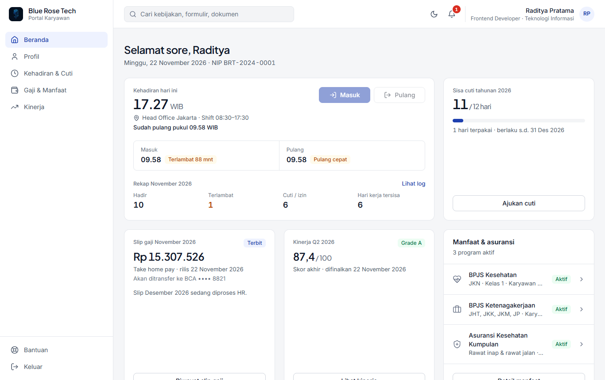 | 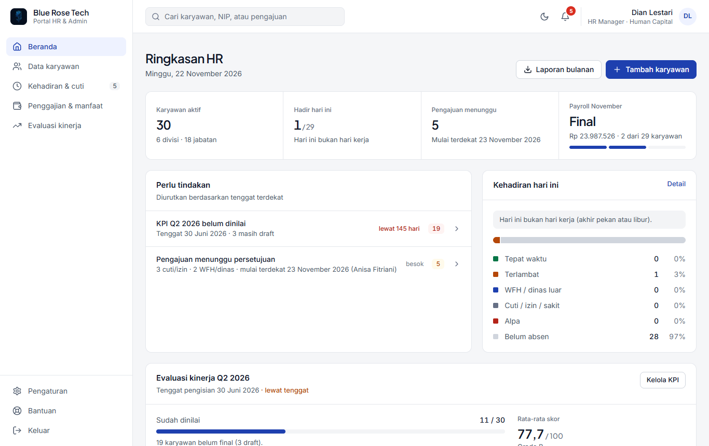 |
| 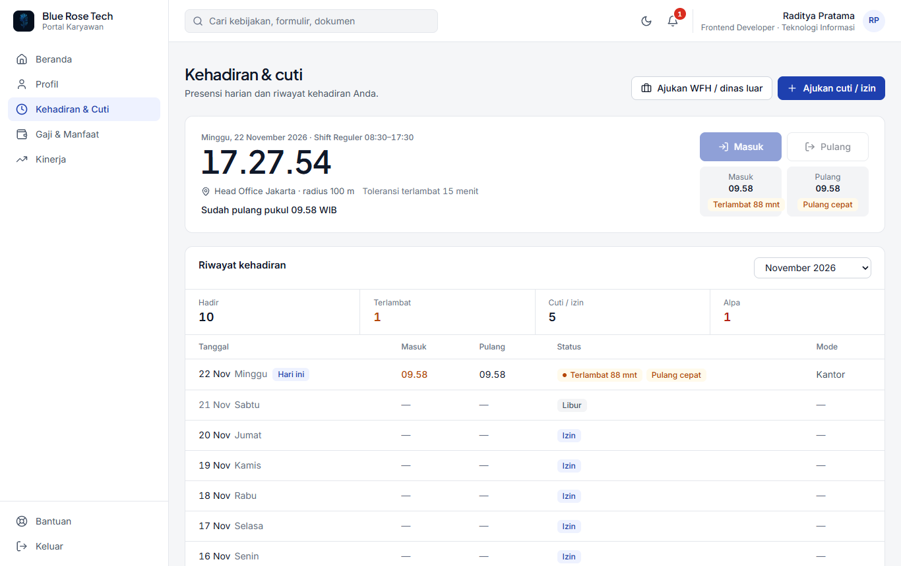 | 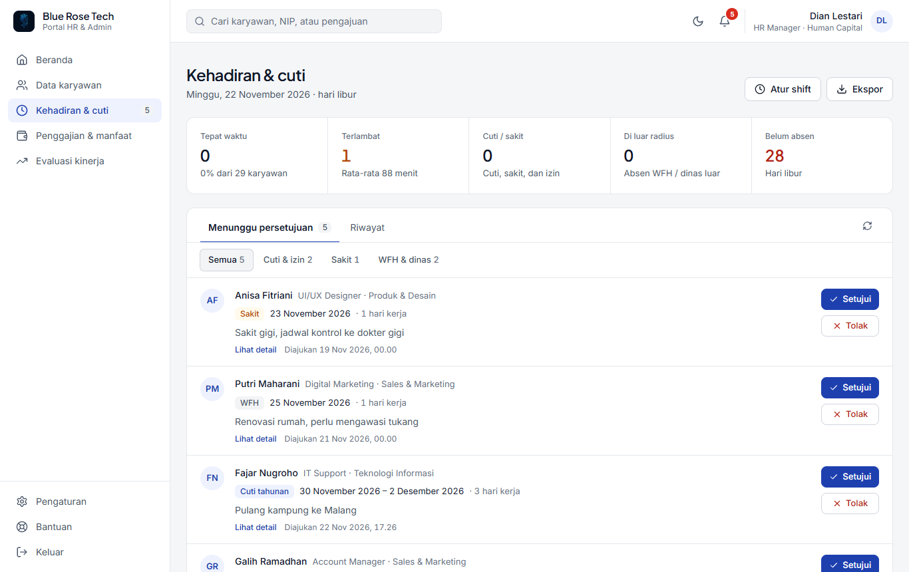 |
| 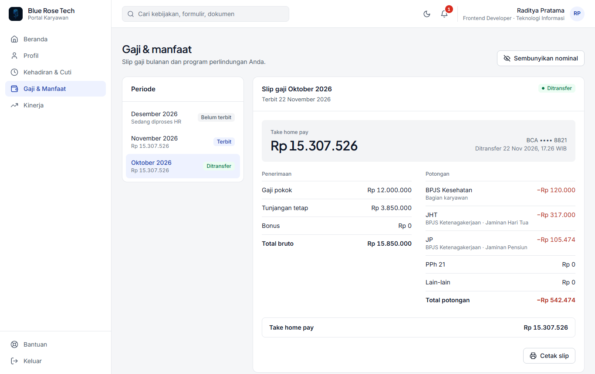 | 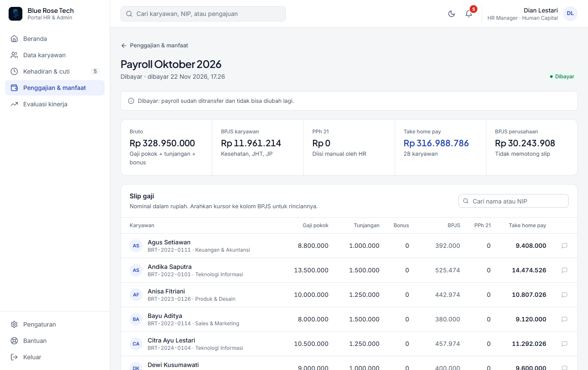 |
| 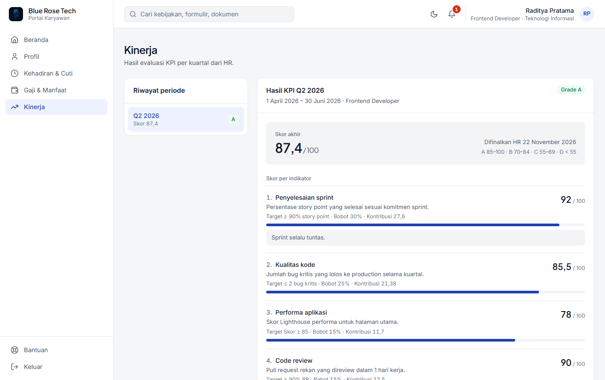 | 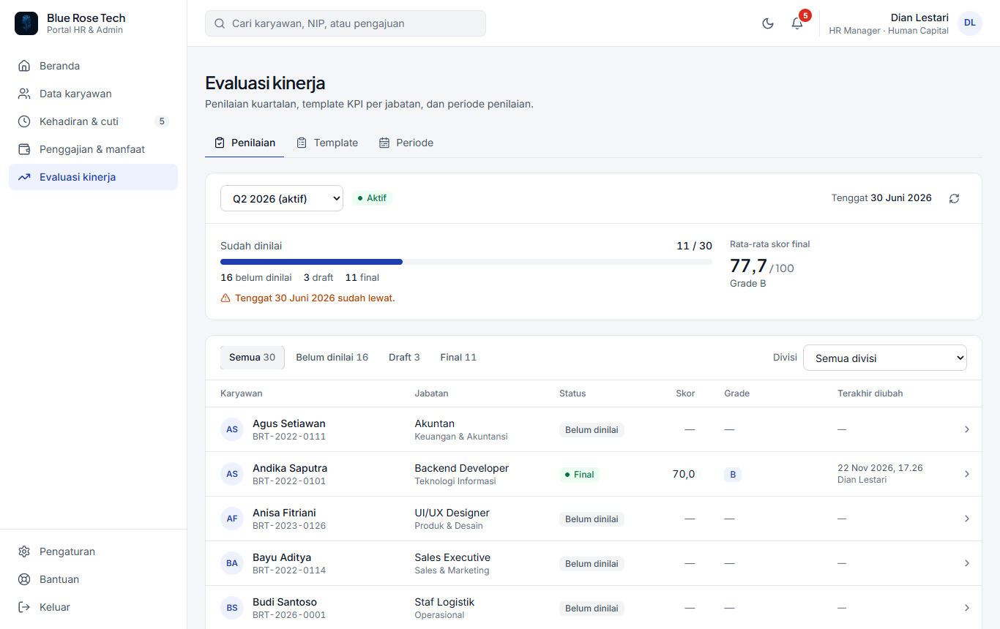 |
| 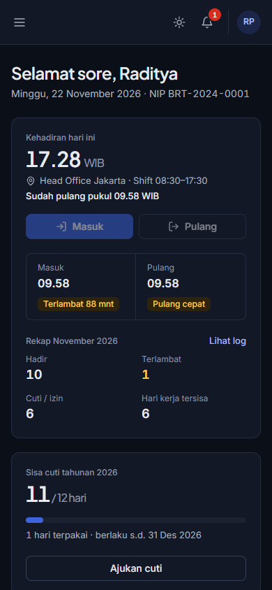 | 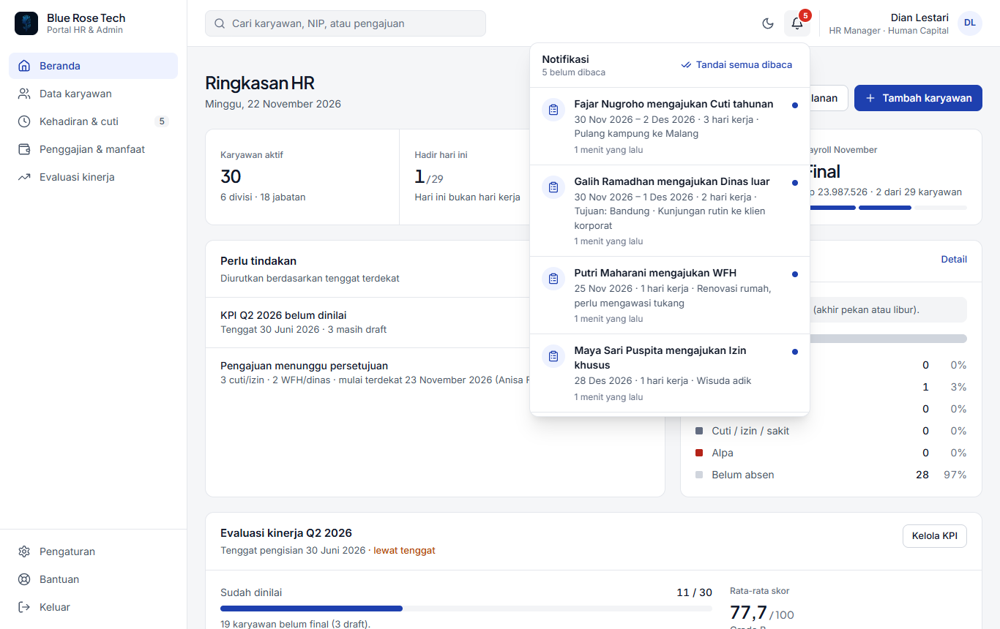 |

## Fitur per role

### Karyawan (`/app`)

- **Login, lupa & ganti kata sandi** (Supabase Auth). Karyawan yang login ke portal HR ditolak, dan sebaliknya.
- **Beranda**: sapaan sesuai jam WIB, status absen hari ini, rekap kehadiran bulan ini, sisa cuti, slip terakhir, hasil KPI terakhir, manfaat aktif. Satu panggilan RPC `my_dashboard()`.
- **Absen masuk/pulang berbasis GPS**: jarak ke kantor dihitung di server (haversine). Di luar radius ditolak kecuali ada izin WFH/dinas yang disetujui. Status tepat waktu, terlambat, atau pulang cepat dihitung dari shift.
- **Pengajuan** cuti tahunan (memotong kuota), sakit (lampiran), izin khusus, WFH, dan dinas luar. Pengajuan yang masih menunggu bisa dibatalkan.
- **Riwayat kehadiran** per bulan.
- **Profil**: ubah data diri dan foto. Data organisasi (jabatan, divisi, gaji) hanya bisa diubah HR.
- **Gaji & manfaat**: slip gaji per periode (siap cetak/PDF), sembunyikan nominal, BPJS Kesehatan, BPJS Ketenagakerjaan, dan asuransi.
- **Kinerja**: skor per indikator, skor akhir, grade, catatan HR, dan riwayat kuartal.
- **Notifikasi realtime**: pengajuan disetujui/ditolak, slip terbit, hasil KPI final.

### HR (`/hr`)

- **Ringkasan**: karyawan aktif, kehadiran hari ini per status, pengajuan menunggu, status payroll bulan berjalan, progres KPI, daftar "Perlu tindakan" yang diurutkan berdasarkan tenggat, dan unduhan CSV laporan bulanan. Satu panggilan RPC `hr_dashboard()`.
- **Data karyawan**: daftar dengan pencarian, filter, dan pagination; undang karyawan baru lewat email (Edge Function); ubah data; riwayat gaji; nonaktifkan akun.
- **Master data & pengaturan**: divisi, jabatan, kantor (titik GPS + radius), shift, hari libur.
- **Kehadiran & cuti**: log presensi semua karyawan (termasuk di luar radius dan alpa), ekspor CSV, serta approval cuti/izin/WFH/dinas dengan catatan. HR tidak bisa menyetujui pengajuannya sendiri.
- **Penggajian**: payroll bulanan Draft → Final → Dibayar, BPJS karyawan dan perusahaan dihitung otomatis, bonus/PPh 21 manual, buka ulang run dengan alasan.
- **Evaluasi kinerja**: template KPI per jabatan (total bobot 100%), periode kuartalan, penilaian per karyawan dengan skor akhir dan grade yang dihitung saat mengetik.
- **Audit log** di database (`audit_logs`, hanya bisa dibaca HR) mencatat approval, perubahan gaji, finalisasi payroll, dan perubahan data karyawan.
- Akun HR mengikuti aturan yang sama: notifikasi pribadi dan tidak bisa menyetujui pengajuan sendiri.

## Tech stack

| Lapisan | Teknologi |
| --- | --- |
| UI | React 18, Vite 6, Tailwind CSS 3 (design token + dark mode), lucide-react |
| Routing | React Router 6 (`/app/*`, `/hr/*`) |
| Data client | `@supabase/supabase-js` v2 (hanya anon key) |
| Database | Supabase Postgres + Row Level Security di semua tabel |
| Logika server | Postgres functions (RPC `security definer`), Supabase Edge Functions (Deno) |
| Auth | Supabase Auth (email + password, undangan email) |
| File | Supabase Storage (`avatars` publik, `attachments` privat) |
| Realtime | Supabase Realtime (`postgres_changes` pada `notifications`) |
| Job terjadwal | `pg_cron` (tandai alpa setiap hari 23:59 WIB) |
| Kualitas | ESLint 9, Prettier 3, uji RLS (`supabase/tests/rls.sql`) |
| Hosting | Vercel (frontend), Supabase (backend) |

## Arsitektur

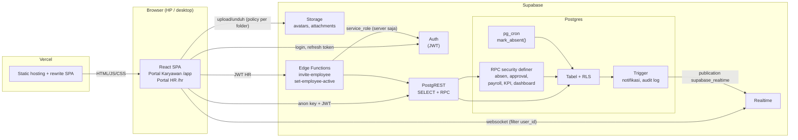

- Browser hanya memegang **anon key**. `service_role` hanya ada di Edge Function.
- Client tidak pernah menulis langsung ke `attendances`, `payslips`, `requests`, atau tabel KPI. Semua lewat RPC yang memeriksa `auth.uid()` dan `is_hr()`.
- Jarak GPS, status keterlambatan, BPJS, take home pay, dan skor KPI dihitung di server, jadi tidak bisa dimanipulasi dari browser.

### Skema database

| Kelompok | Tabel |
| --- | --- |
| Organisasi | `divisions`, `positions`, `offices`, `shifts`, `holidays`, `profiles` |
| Presensi | `attendances` |
| Cuti & izin | `leave_types`, `leave_balances`, `requests` |
| Penggajian | `salary_components`, `benefits`, `payroll_settings`, `payroll_runs`, `payslips` |
| KPI | `kpi_templates`, `kpi_indicators`, `kpi_periods`, `kpi_reviews`, `kpi_scores` |
| Sistem | `notifications`, `audit_logs` |

Semua migrasi ada di [`supabase/migrations`](supabase/migrations). Detail kolom dan aturan bisnis ada di [PRD](PRD%20—%20HRIS%20Blue%20Rose%20Tech.md).

### Keamanan & uji RLS

`supabase/tests/rls.sql` membuktikan bahwa, sebagai karyawan A:

- tidak bisa membaca, mengubah, atau menghapus data karyawan B di setiap tabel;
- tidak bisa insert langsung ke `attendances`, `payslips`, dan tabel lain yang hanya boleh ditulis server;
- tidak bisa menaikkan role sendiri;
- tidak bisa memanggil 25 RPC khusus HR dan fungsi internal.

Skrip juga memeriksa bahwa anon tidak bisa membaca tabel apa pun, semua tabel ber-RLS, dan setiap RPC yang terbuka sudah diaudit. Data uji dibuat lalu dibatalkan, jadi aman dijalankan di cloud:

```bash
npx supabase db query --remote -f supabase/tests/rls.sql   # cloud
npx supabase db query -f supabase/tests/rls.sql            # lokal
# Hasil: "RLS AUDIT LULUS: 130/130 pemeriksaan ..."
```

## Setup lokal

Prasyarat: **Node.js 20+**, **Docker Desktop** (untuk Supabase lokal), dan Git.

1. Clone repo dan pasang dependensi frontend:

   ```bash
   git clone <url-repo> hris-blue-rose-tech
   cd hris-blue-rose-tech/dashboard
   npm install
   cd ..
   ```

2. Jalankan Supabase lokal (Postgres, Auth, Storage, Realtime, Studio):

   ```bash
   npx supabase start
   ```

   Catat `API URL` dan `anon key` dari output-nya. Bisa juga dilihat lagi dengan `npx supabase status`.

3. Buat database dari migrasi + seed. Perintah ini menjalankan semua file di `supabase/migrations`, lalu `seed.sql` (master data) dan `seed-demo.sql` (akun demo, 28 karyawan fiktif, absen 2 bulan, pengajuan, payroll, KPI):

   ```bash
   npx supabase db reset
   ```

4. Isi environment frontend:

   ```bash
   cp dashboard/.env.example dashboard/.env
   # VITE_SUPABASE_URL=http://127.0.0.1:54321
   # VITE_SUPABASE_ANON_KEY=<anon key dari langkah 2>
   ```

5. (Opsional) Jalankan Edge Functions untuk fitur undang/nonaktifkan karyawan:

   ```bash
   npx supabase functions serve
   ```

6. Jalankan aplikasi, lalu buka http://localhost:5173 dan login dengan akun demo di atas:

   ```bash
   cd dashboard
   npm run dev
   ```

7. (Opsional) Uji RLS: `npx supabase db query -f supabase/tests/rls.sql`

Skrip frontend (di `dashboard/`): `npm run dev`, `npm run build`, `npm run preview`, `npm run lint`, `npm run format`, `npm run format:check`.

> Absen GPS butuh HTTPS atau `localhost`. Untuk mencoba dari HP di jaringan yang sama, gunakan tunnel HTTPS atau deploy ke Vercel.

## Deploy

### 1. Supabase (cloud)

```bash
npx supabase login
npx supabase link --project-ref <project-ref>
npx supabase db push                                         # semua migrasi
npx supabase db query --remote -f supabase/seed.sql          # master data
npx supabase db query --remote -f supabase/seed-demo.sql     # data demo (opsional)
npx supabase functions deploy invite-employee set-employee-active
```

Edge Functions memakai `SUPABASE_URL`, `SUPABASE_ANON_KEY`, dan `SUPABASE_SERVICE_ROLE_KEY` yang otomatis tersedia di Supabase. Tidak ada secret yang perlu ditambahkan.

### 2. Vercel

1. Import repo di Vercel. Set **Root Directory** = `dashboard`. Framework Vite terdeteksi dari `dashboard/vercel.json`, yang juga berisi rewrite SPA ke `index.html`, cache aset, dan header keamanan.
2. Isi **Environment Variables** untuk Production dan Preview:

   | Nama | Nilai |
   | --- | --- |
   | `VITE_SUPABASE_URL` | `https://<project-ref>.supabase.co` |
   | `VITE_SUPABASE_ANON_KEY` | anon / publishable key (Project Settings → API) |

   Jangan pernah menambahkan `service_role` key ke Vercel.
3. Deploy, lalu catat domainnya, misalnya `https://hris-blue-rose-tech.vercel.app`.

### 3. URL Auth di Supabase

Buka Dashboard Supabase → **Authentication → URL Configuration**:

| Setelan | Nilai |
| --- | --- |
| Site URL | `https://<domain-vercel>` |
| Redirect URLs | `https://<domain-vercel>/update-password`<br>`https://<domain-vercel>/**`<br>`http://localhost:5173/update-password` |

Tautan reset kata sandi dan undangan karyawan mengarah ke `/update-password`. Kalau ingin mencoba dari Preview deployment Vercel, tambahkan juga pola domain preview, misalnya `https://*-<tim>.vercel.app/**`.

## Struktur folder

```text
.
├── dashboard/                   # Frontend React + Vite (root project Vercel)
│   ├── public/assets/           # Logo
│   ├── src/
│   │   ├── App.jsx              # Portal Karyawan (/app/*)
│   │   ├── AppRouter.jsx        # Routing per role
│   │   ├── components/          # Halaman & kartu portal karyawan, komponen UI bersama (ui.jsx)
│   │   │   └── hr/              # Halaman Portal HR (karyawan, payroll, KPI, pengaturan, beranda)
│   │   ├── context/             # AuthContext (sesi + profil)
│   │   └── lib/                 # Klien Supabase, hook data, helper format per modul
│   ├── eslint.config.js
│   ├── .prettierrc.json
│   └── vercel.json
├── supabase/
│   ├── migrations/              # Skema, RLS, RPC, trigger (urut waktu)
│   ├── functions/               # Edge Functions (invite-employee, set-employee-active)
│   ├── tests/rls.sql            # Audit Row Level Security
│   ├── seed.sql                 # Master data (divisi, jabatan, kantor, shift, libur, contoh KPI)
│   ├── seed-demo.sql            # Data demo fiktif
│   └── config.toml              # Konfigurasi Supabase lokal
├── docs/screenshots/            # Screenshot untuk README
└── PRD — HRIS Blue Rose Tech.md # Product Requirements Document
```
